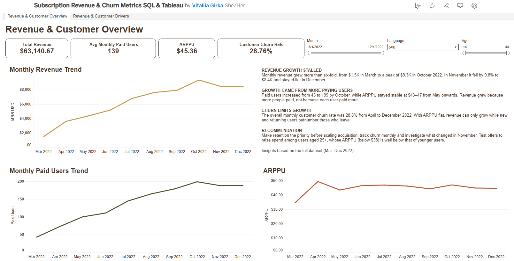
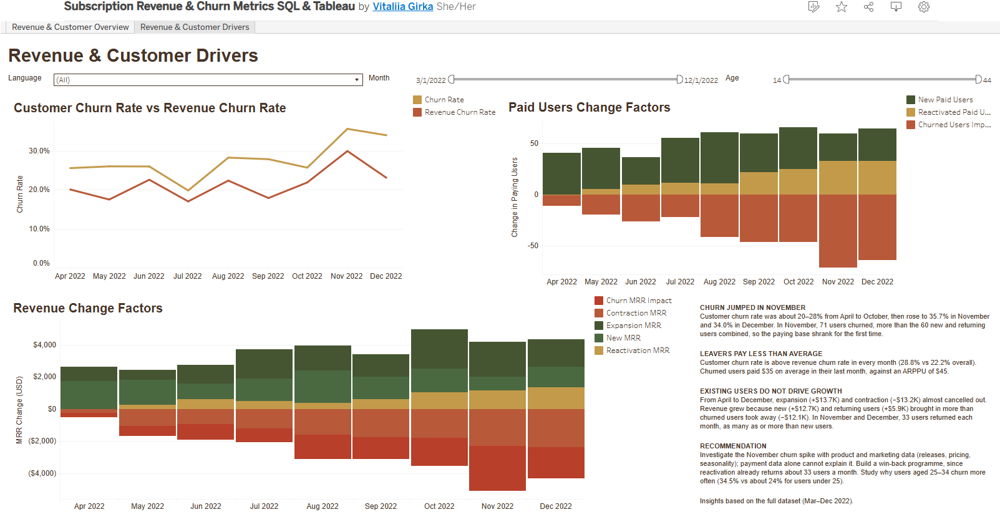

# Game Revenue & Customer Analytics — PostgreSQL & Tableau

An end-to-end analysis of monthly revenue, paying-user dynamics and churn for a mobile game (March–December 2022). I built a PostgreSQL metrics model, validated its results against raw payment data and designed two interactive Tableau dashboards to explain **what changed, what drove the change and what should be investigated next**.

**[Explore the interactive dashboards on Tableau Public](https://public.tableau.com/shared/RSC9942F8)**

*GoIT Data Analytics course project. The course provided the dataset; the analysis and dashboards were developed with AI assistance, described below.*

## Key findings

- **Revenue growth stalled after October.** Monthly revenue rose from $1.5K in March to $9.3K in October 2022, fell 9.8% to $8.4K in November, and was broadly flat in December.
- **Paying-user growth was the main driver from May onward.** Paying users increased from 43 in March to 199 in October, while monthly ARPPU remained broadly within $43–47 from May onward.
- **November churn reversed user growth.** Customer churn reached 35.7%; 71 users churned, exceeding the 60 new and reactivated users combined. Paying users fell from 199 to 188.
- **Churned users generally generated less revenue than the paying-user base.** Across April–December, the aggregated customer churn rate was 28.8%, versus a revenue churn rate of 22.2%. Churned users had contributed approximately $35 each in their final paid month, compared with overall ARPPU of approximately $45 per paid user-month.
- **Changes in retained users' spending largely offset each other.** Expansion MRR (+$13.7K) and contraction MRR (−$13.2K) nearly canceled out. New MRR (+$12.7K) and reactivation MRR (+$5.9K) more than offset churned revenue (−$12.1K).
- **Reactivation became important.** Reactivated paid users reached 33 per month in November and December, compared with 27 and 32 new paying users, respectively.
- **Age segments merit further investigation.** In this dataset, users under 25 contributed roughly 75% of revenue; users aged 25–34 had lower ARPPU and higher measured churn. Segment results should be interpreted cautiously for smaller groups.

## Business context

Product managers want to understand how monthly revenue and the paying-user base develop, why they change, and whether retention or monetization is limiting growth. The central questions are:

- How do monthly revenue, paying users and ARPPU change over time?
- How much of the month-over-month change comes from new, reactivated and churned customers, or from changes in retained customers' spending?
- How do customer and revenue churn compare, and which age or language segments warrant attention?

**My analytical contribution:** translating these questions into metric definitions, selecting the correct data grain, reviewing and refining the SQL logic, validating reconciliation, and communicating findings through interactive dashboards.

## Data

| Property | Detail |
|---|---|
| Source | PostgreSQL database provided by GoIT, schema `project` |
| Tables | `games_payments`: `user_id`, `game_name`, `payment_date`, `revenue_amount_usd` `games_paid_users`: `user_id`, `game_name`, `language`, `has_older_device_model`, `age` |
| Raw grain | One row per payment; one profile per user (verified for this dataset) |
| Period | 1 March–31 December 2022 |
| Size | 3,026 payments; 383 paying users |
| Model output | 1,392 paying user-months plus 346 churn events; 1,738 rows |

**Exploration and quality checks** are documented in [`sql/01_data_exploration.sql`](sql/01_data_exploration.sql). The checks found no missing payment dates or amounts, no non-positive payment amounts, no missing profile matches, and no duplicate user profiles. Multiple payments occurred in 59% of paying user-months, so I aggregated payments before comparing months. I also identified 152 return-after-gap events that required a separate reactivation category.

## SQL approach and analytical decisions

The model in [`sql/02_revenue_metrics.sql`](sql/02_revenue_metrics.sql) uses modular CTEs:

1. `monthly_payments` — aggregates revenue by user, game and calendar month.
2. `user_history` — identifies each user's observed first and last payment months.
3. `dataset_bounds` — identifies the observable period.
4. `payment_comparison` — uses `LAG()` and `LEAD()` to compare paid months with adjacent calendar months.
5. `revenue_events` — classifies new, returning, retained and churned users, adding churn events to the following month using `UNION ALL`.

The final output is at **user × game × calendar-month** grain, including months represented by churn events. Language and age are joined for dashboard filtering.

**Business rules that matter:**

- Churn occurs in the **first month without payment**, not the user's last paid month.
- Churn is not projected into January 2023, because data ends in December 2022.
- Reactivation is separate from acquisition and retained-user expansion: without it, the revenue bridge would not reconcile.
- For April–December, the monthly change is reconciled as:

  `MRR change = New MRR + Reactivation MRR + Expansion MRR + Contraction MRR − Churned Revenue`

- ARPPU and churn rates are calculated in Tableau as **ratio of sums**, rather than averages of row-level ratios, so they remain meaningful when filtering by age or language.

## Interactive Tableau dashboards

| Dashboard | Purpose |
|---|---|
| **Revenue & Customer Overview** | Summarizes Total Revenue, Avg Monthly Paid Users, ARPPU and aggregated Customer Churn Rate; displays monthly revenue, user-count and ARPPU trends. |
| **Revenue & Customer Drivers** | Explains month-over-month changes in revenue and paid users and compares customer churn with revenue churn. |

Both dashboards include payment-month, language and age filters. **The narrative findings shown in text boxes summarize the complete, unfiltered March–December 2022 dataset; they do not recalculate when filters change.** Charts and KPIs are interactive.

## Metrics

| Metric | Definition | Implemented in |
|---|---|---|
| MRR | Revenue received during a calendar month, treated as recurring for this course project | SQL |
| Paid Users | Users with at least one payment in a month | SQL |
| ARPPU | Monthly revenue / paying users | Tableau |
| New Paid Users / New MRR | Users first observed paying in a month, and their revenue | SQL |
| Reactivated Paid Users / Reactivation MRR | Users returning after a month or more without payment, and their revenue | SQL |
| Churned Users / Churned Revenue | Previous-month payers absent this month, and their last paid-month revenue | SQL |
| Customer Churn Rate | `SUM(Churned Users) / SUM(Previous Month Paid Users)` | Tableau |
| Revenue Churn Rate | `SUM(Churned Revenue) / SUM(Previous Month MRR)` | Tableau |
| Expansion MRR / Contraction MRR | Positive / negative spending changes among continuously paying users | SQL |

**Coverage:** 11 of the 13 course metrics are displayed across the two dashboards. Observed customer lifetime and observed lifetime revenue are also calculated in SQL, but deliberately excluded from the dashboard because the ten-month observation window does not establish complete customer lifetimes.

**KPI interpretation:** Total Revenue sums the selected months. Average Monthly Paid Users is a monthly average, not a distinct-user count across the whole period. The multi-month ARPPU is revenue divided by paying user-months; multi-month churn is a pooled ratio using the previous-month bases, not the arithmetic mean of monthly rates.

## Validation

Validation queries are in [`sql/03_validation_checks.sql`](sql/03_validation_checks.sql). I compared the model's monthly revenue and paying-user counts with independent aggregates from the raw payments table, and checked that the revenue and user movement bridges reconcile for April–December 2022. The stored previous-month paying-user base was also compared with the prior month's observed paid users.

**Reproducibility:** the original PostgreSQL course database is required to rerun the SQL. Start with exploration (`01`), run the metrics query (`02`), save its output as a temporary table called `revenue_metrics`, then run the validation checks (`03`). The underlying course dataset is not distributed in this repository.

## Recommendations

- **Investigate the November churn spike** using product-release, pricing, billing and marketing data before attributing a cause. Payment data alone cannot identify the reason.
- **Monitor customer and revenue churn together.** Users leaving tend to contribute less revenue than the average paying user, so customer losses and immediate revenue losses convey different risks.
- **Test retention and win-back hypotheses** before scaling acquisition. Returning users already contribute meaningfully, but their long-term retention still needs investigation.
- **Validate age-related differences with segment sizes and additional periods** before designing targeted offers or making causal claims.

## Limitations

- **Left-censoring:** all March 2022 payers are classified as new within the observed data, though some may have paid before March. Month-over-month churn analysis starts in April.
- **Right-censoring:** data ends in December 2022; later payments or churn are unknown. Observed lifetime and user revenue are not complete lifetime estimates.
- **Ten months:** seasonality cannot be separated reliably from the observed trend.
- **Payment data only:** prices, product changes, cancellations and marketing activity are unavailable. Findings describe changes and plausible hypotheses, not proven causes.
- **Small segments:** only eight users have the `en` language label, and 24 users are aged 35+. Segment-level rates can be unstable.
- **MRR approximation:** for consistency with the course assignment, monthly payment revenue is treated as recurring even though actual contract and renewal terms are not available.

## Files

| Path | Contents |
|---|---|
| [`sql/01_data_exploration.sql`](sql/01_data_exploration.sql) | Initial exploration, grain and quality checks, recorded results |
| [`sql/02_revenue_metrics.sql`](sql/02_revenue_metrics.sql) | CTE-based metrics model feeding Tableau |
| [`sql/03_validation_checks.sql`](sql/03_validation_checks.sql) | Reconciliation and validation checks |
| [`images/`](images/) | Screenshots of both dashboards |

## Tools and skills demonstrated

**PostgreSQL / SQL:** CTEs, `DATE_TRUNC`, `LAG` / `LEAD`, `UNION ALL`, aggregation, joining at the correct grain, metric reconciliation and data-quality checks.  
**Tableau Public:** calculated measures, ratio-of-sums KPIs, interactive filters, diverging stacked-bar comparisons, dashboard layout and visual storytelling.  
**Analytical thinking:** metric definitions, churn event timing, reactivation logic, data limitations, findings and recommendations.

## AI-assisted workflow

I used Claude Code and another AI assistant to help draft and refine SQL, organize requirements and review possible edge cases. I defined and evaluated the business logic, investigated the data, checked calculations against independent totals, reviewed the generated queries and built the Tableau dashboards. AI assistance is disclosed here because it formed part of the project workflow; the conclusions and final presentation reflect my own review and analytical decisions.
